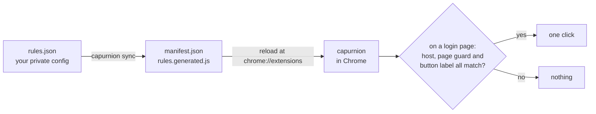

# capurnion

**Finish the sign-ins you repeat every day: one guarded click by default, and with a local encrypted vault, Okta and token renewals too.**

<!-- bricoleur:intro -->
> Part of **[bricoleur.ai](https://bricoleur.ai)**: small, honest tools cobbled together from the AI-era parts at hand. Related: **[keeBLEr](https://github.com/shawnrancatore/keeBLEr)**, another tool that works from the browser you already have open.
<!-- /bricoleur:intro -->



## What it does

- **Clicks the "Sign in with *provider*" button** on the login pages you name in one JSON file:
  once per page load, and only when the host, your page guards and the button's label all match.
- **Signs in to one Okta tenant, if you opt in.** Your email and password come from a local encrypted
  vault, and the SMS code from a small relay such as 2fu.
- **Keeps one Snowflake account's programmatic access tokens usable, if you opt in.** An hourly check
  in a background tab resets any token's network-policy bypass to 24 hours once under two hours remain.

## Quick start

You need Chrome and Python 3. Node is needed only for `capurnion test` and the test suite.

```sh
git clone https://github.com/bricoleur-ai/capurnion
cd capurnion
bin/capurnion init      # creates your private rules.json, every rule off, and syncs
```

In Chrome, open `chrome://extensions`, turn on **Developer mode**, click **Load unpacked** and choose
the `capurnion` folder. Then run `bin/capurnion doctor`. It worked if Chrome lists **Capurnion —
SSO/OAuth login auto-click** and `doctor` ends with `no problems` (on macOS it also checks that Chrome
has it registered). Every rule starts off, so nothing is clicked yet: [Adding a site](#adding-a-site)
turns on your first.

## How it works

`capurnion sync` turns `rules.json` into the two files Chrome loads: a manifest that asks only for the
hosts of your enabled rules, and those rules. On those hosts a content script watches the page as it
renders. When every guard of a rule passes and its button appears, it clicks once and stops; if not,
it gives up after 15 seconds by default. The decision lives in `matcher.js`, and `capurnion test` runs
that same file, so a dry run and the browser cannot disagree. The vault, Okta sign-in and Snowflake
renewal add a service worker that loads only what you enable. The
[technical brief](https://bricoleur.ai/projects/capurnion/how-it-works) walks through it.

## What it deliberately does not do

- **No MFA push or approve prompts, ever.** The project does not automate them: to the extension an
  MFA "Approve" looks like a consent "Allow", and clicking it for you defeats the second factor. Okta
  sign-in drives only the SMS factor, never an Okta Verify push or a password-less step-up.
- **No typing from rules.** A rule only clicks. The only fields capurnion fills belong to the two
  opt-in workflows: your Okta sign-in, and the Snowflake bypass duration.
- **No permissions you did not ask for.** Disabled rules ship nothing, and `init` starts with none.
- **No server of its own, and nothing in sync storage.** Secrets are encrypted at rest in this profile.
  The only requests it makes itself go to your 2fu relay and your Okta host's session endpoint, once
  you configure them. It never reads or saves Snowflake token secrets, Okta session IDs or cookies.
- **No build step and no runtime dependencies.** Chrome loads the plain JavaScript as it is; the CLI
  uses only Python's standard library.
- **No waking up.** Chrome must be running; its alarms do not wake a sleeping computer.

## Your config never enters the repo

`rules.json` names the hosts you sign in to. It holds no credentials, but it does describe your
employer, your vendors and your tenants, so it is **gitignored**, as are the two files generated from
it, `manifest.json` and `rules.generated.js`. Secret values never go in it: the Okta capability names
vault entries, and the vault holds the values.

The tracked `rules.example.json` holds the same kinds of rules with `REPLACE-ME` hosts, all disabled;
`init` copies it to `rules.json`. A fresh clone will not load in Chrome until `init` or `sync` has
generated the manifest: an empty extension is a better default than one with someone else's hosts.

## Adding a site

**With an agent driving Chrome.** The agent has to see the page to know what to click, so there is a
read-only probe. `capurnion probe` prints a JS snippet; run it in the tab on the login page with Claude
in Chrome's `javascript_tool`, Playwright's `page.evaluate`, or DevTools. It returns the host, the
headings you could guard on, and every clickable label, SSO-looking ones first, and clicks nothing.
Save that JSON and hand it to `draft`:

```sh
capurnion draft --from probe.json
#   * [ 0] Sign in with Okta
#   * [ 1] Continue with Google
#     [ 2] Sign in

capurnion draft --from probe.json --pick 0 --id acme-app --guard "sign in to acme" --add
capurnion sync
```

`draft` refuses to create a rule with no page guard, and prints the page's own headings as
ready-to-paste `--guard` values. [AGENTS.md](AGENTS.md) holds the rules an agent must follow.

**By hand.** Edit `rules.json`, run `capurnion test <url> --text "<text on the page>"` until it says
`WOULD FIRE`, then `capurnion sync`. Starting from an `example-*` rule? Replace its `REPLACE-ME` host
**before** enabling it: `capurnion enable` refuses a placeholder host and leaves the file unwritten.

Either way, finish by clicking **reload** on the capurnion card at `chrome://extensions`; content
scripts and host permissions do not change until you do. `capurnion doctor` reports `STALE` if you
forgot `sync`, but it cannot tell whether you reloaded.

## Rule schema

```json
{
  "id": "acme-app",
  "description": "Acme's login page -> Okta",
  "enabled": true,
  "kind": "idp-select",
  "hosts": ["app.example.com", "*.login.example.com"],
  "require": { "pageText": "sign ?in to acme" },
  "click":   { "label": "sign in with okta|continue with okta" },
  "options": { "timeoutMs": 15000, "delayMs": 0 }
}
```

| Field | Required | Meaning |
|---|---|---|
| `id` | yes | Unique; lowercase letters, digits, dashes. |
| `description` | strongly | What it does. Agents read this to pick a rule to edit. |
| `enabled` | yes | Disabled rules ship nothing and cost **no host permissions**. |
| `kind` | yes | Safety tier; see [Security model](#security-model). |
| `hosts` | yes | Bare hostnames. `*.example.com` matches subdomains and the apex. |
| `require.pageText` | no | Case-insensitive regex the page's visible text must match. |
| `require.url` | no | Case-insensitive regex the full URL must match. |
| `click.label` | yes | Case-insensitive regex matched against the button's visible label. |
| `click.selector` | no | CSS override. Default: `button, a, [role=button], input[type=submit\|button]`. |
| `options.timeoutMs` | no | Stop watching the page after this. Default 15000. |
| `options.delayMs` | no | Wait before clicking; re-checks the button is still there. |
| `allFrames` | no | Also run inside iframes, for framed consent screens. |
| `confirmGrantsAccess` | consent only | Must be `true` for a `consent-grant` rule to run. |

A rule fires when **every** guard passes. With no `require` it clicks any matching button anywhere on
those hosts, and `validate` warns about it.

## Security model

SSO rules read the page and call `.click()`, at most **once per page load**, on the hosts of enabled
rules only.

| `kind` | Clicks | |
|---|---|---|
| `idp-select` | "Sign in with Okta / Google / Microsoft / SSO" | Navigational: picks an identity provider and grants nothing. The default; covers almost every case. |
| `session-continue` | "Continue as *user*", "Stay signed in?" | Grants nothing, but clicks past a screen you may have wanted to read. |
| `consent-grant` | "Allow" / "Authorize" on an OAuth consent screen | **Grants an application access to your account.** Needs `"confirmGrantsAccess": true`; the engine refuses it otherwise, and `validate` errors. |

Scope a `consent-grant` rule to one host. On a shared IdP domain such as `accounts.google.com` or
`login.microsoftonline.com`, it would approve every application that asks.

Each capability is off until you enable it, and each needs Chrome 120 or newer. `sync` adds:

| Capability | Permissions and scripts |
|---|---|
| Snowflake renewal | `alarms`, `storage`, `notifications`, `scripting`, and `https://app.snowflake.com/*` as a host permission; the service worker and popup; a content script on your account's pages (`…/<org>/<account>/*`), and the late-SSO watch beside your SSO rules. capurnion uses `scripting` only to re-attach that content script to the check's own tab. |
| Vault | `storage`, and `unlimitedStorage` so the device key survives eviction; the settings page. No website permissions. |
| Okta sign-in | `storage` and the service worker; a content script on the one Okta host; the relay's origin. With renewal on too, the Okta host, for the session check. |

**Where vault secrets go.** Secrets are encrypted at rest in this profile's local extension storage,
and decrypted in two places. The Settings & vault panel holds every entry while management is
unlocked, and clears them when it locks. The service worker decrypts the vault on each use with the
device key, keeps the one value asked for and clears the rest, whether or not management is locked.
The only code that asks the worker for secrets is Okta sign-in, for its two named entries. The worker
hands them only to capurnion's content script in the top frame of a page on the configured Okta
host, and its sender check enforces all three. That script asks only while the sign-in form is
showing, and types the values into it, so from then on **the page can read your password**, as with
any password manager.

## The local encrypted vault

Add `"vault": { "enabled": true }` beside `rules`, sync, and reload, then open **Settings & vault** from
the toolbar icon (through the popup's button when Snowflake renewal is on) or **Extension options**.
Create a vault with a passphrase of at least 12 characters, then add, edit, reveal and delete secrets.
Names and values are stored encrypted together in this profile's local extension storage: never in
`rules.json`, the generated config or browser sync storage.

Encryption is Web Crypto AES-256-GCM with a fresh 96-bit nonce on every save, under a key derived by
PBKDF2-HMAC-SHA-256 (600,000 iterations, random 128-bit salt). The non-exportable key is kept as a
`CryptoKey` in the extension's IndexedDB, so automations keep access across panel closes and worker and
Chrome restarts, with no stored passphrase. Trusted extension code reads one value with
`await CAPURNION_VAULT_ACCESS.getSecret("exact-secret-name")`, fresh on every call; the
[Security model](#security-model) says where decrypted values go.

**Lock management** protects viewing and editing in the panel, not automation access. Closing the
panel, or five idle minutes, clears its secret fields, decrypted entries and key reference. Keep the
passphrase safe: it is not stored. A lost device key is restored by unlocking management, without
losing secrets, and a failed write leaves the previous passphrase and secrets usable. Setting
`vault.enabled` to `false` removes access and the panel but keeps the encrypted vault for later.

**What it does not protect against.** Locking is not cryptographic revocation: the automation key
stays in the profile and keeps decrypting. Non-exportable only means Web Crypto will not hand out the
key's bytes; it is not a hardware-backed key or an OS keychain, and it does not protect you from a
compromised browser or profile, or from anyone in control of the extension.

## Okta sign-in (vault and 2fu)

This signs you in to one Okta tenant **in the browser**. On the sign-in page it fills your **email and
password from the vault**, then completes the **SMS** factor: it selects Phone, asks for a code, fetches
the code from a small HTTP relay you run, and clicks Verify. Pair it with an `idp-select` rule on an
app's login page, and a cold visit signs in hands-off. It automates your **second factor**, so enable
it only for your own account on your own machine. In the private `rules.json`, beside `rules`:

```json
"oktaLogin": {
  "enabled": true,
  "confirmAutomatesMfa": true,
  "host": "example.okta.com",
  "usernameSecret": "ou",
  "passwordSecret": "op",
  "smsCodeUrl": "http://2fu.local:8787/code?client=laptop"
}
```

- `confirmAutomatesMfa` must be literally `true`, or `validate` and `sync` refuse it. `host` is the one
  Okta hostname; the content script runs only there, in the top frame.
- `usernameSecret` and `passwordSecret` name [vault](#the-local-encrypted-vault) entries (default `ou`
  and `op`), so `vault.enabled` must be `true`.
- `smsCodeUrl` answers `{"code":"123456"}` once a code is ready, and anything but `200` before then.
  The 2fu relay does exactly this: your phone forwards the text, and it hands the code over once. Its
  origin becomes a host permission. Keep it on a network you trust; it carries codes in the clear.

It takes one action per screen: fill both fields and Sign in; select Phone; ask for the SMS; then poll
the relay every three seconds for up to two minutes, fill the code and Verify. The service worker
decrypts the two secrets and hands them only to this content script, in the top frame of a page on
the Okta host. The script checks that the sign-in form is still showing, types them in and clears its
own copies; from then on the page can read the password (see [Security model](#security-model)). If
the vault cannot supply the credentials yet, it tries again 30 seconds later. To set it up, save the
two secrets, unlock vault management once so the device has automation access, then sync and reload.

## Snowflake token renewal

Once an hour this opens one Snowflake account's Authentication settings page in a **new, inactive
tab**, lets your SSO rules sign in, and gives each Active programmatic access token with under two
hours of network-policy bypass left a fresh 24 hours. Switching to the tab does not stop the check;
**Pause** in the popup does, as does closing the tab, and the tab closes when the check ends. In the
private `rules.json`, beside `rules`:

```json
"snowflakePat": {
  "enabled": true, "confirmGrantsAccess": true,
  "url": "https://app.snowflake.com/acme/xy12345/settings/authentication",
  "expectedUser": "you@example.com",
  "intervalMinutes": 60, "pollMinutes": 5, "renewBelowMinutes": 120, "grantHours": 24
}
```

`confirmGrantsAccess` is your deliberate opt-in, `expectedUser` must match the account menu's
accessible label, and the URL must be one exact HTTPS settings page. The numbers are fixed, and
`validate` rejects others: a check every 60 minutes, renewal below 120 minutes, grants of 24 hours,
and a 5-minute watchdog poll that retries failed checks. Run `capurnion validate` and `sync`, then
reload the extension at `chrome://extensions` yourself: nothing, `doctor` included, can tell which
version Chrome is running. To turn it off, set `"enabled": false` in this block, sync and reload.

A check waits up to 60 seconds for the Active list to show at least one token, and reports a failure,
never success, if none arrive (so an account with no tokens fails too). A grant counts only once its
dialog has closed and the same row shows 23 to 24 hours left. A lapsed bypass can leave an Active
token with no timer: `restoreMissingAccess: true` grants every such token through its own menu;
without it, only a token whose recorded window has passed while the page reports a missing network
policy gets one. But no timer can also mean a healthy token that a network policy protects, which the
key would grant anyway: it is optional, and your call. The popup shows the current step and page,
**Check now**, **Pause**, **Open check tab**, and how many tokens the last check read and renewed.

**Okta session states.** With Okta sign-in also on, each poll asks your Okta host whether you are
signed in and records **active**, **signed-out** (Okta's own no-session answer) or **unknown**
(anything else, such as a bare 404, a redirect or a timeout). Only signed-out sends the check through
Okta sign-in first. Unknown is never treated as logged out: the check takes your usual SSO flow. The
[guide](https://bricoleur.ai/projects/capurnion/tokens-and-the-vault) covers recovery, the watchdog,
notifications and what is stored.

## CLI

| Command | |
|---|---|
| `capurnion init` | Create `rules.json` from the example and sync. |
| `capurnion list` | Every rule and whether it is on; whether renewal and Okta sign-in are on. |
| `capurnion probe` | Print the read-only page probe to run in a login tab. |
| `capurnion draft --from <json>` | Turn a probe result into a rule. |
| `capurnion test <url> [--text ...]` | Dry run; says exactly why a rule would not fire. |
| `capurnion validate` | Schema check; non-zero exit on error. |
| `capurnion sync` | Regenerate the manifest and shipped rules. |
| `capurnion doctor` | Rules valid? Generated files current? On macOS, registered in Chrome? |
| `capurnion enable/disable <id>` | Flip a rule. |
| `capurnion add < rule.json` | Append a rule from stdin, validated. |

`bin/capurnion` works through a symlink, so it can go on your PATH (`ln -s "$PWD/bin/capurnion"
~/.local/bin/`). `test` runs `matcher.js` through Node: the file the browser runs, not a copy.

## How it is put together

| File | |
|---|---|
| `rules.json`, `rules.example.json` | Your gitignored config, the only file you edit; and the template `init` copies. |
| `manifest.json`, `rules.generated.js` | Generated by `sync`. Gitignored. |
| `matcher.js`, `engine.js` | Whether a rule fires (shared with the CLI); watching the page and clicking once. |
| `bin/capurnion`, `bin/evaluate.js`, `tools/probe.js` | The CLI, its bridge to `matcher.js`, and the page probe. |
| `background.js` | Loads the enabled capabilities into the service worker. |
| `okta-login-*.js` | Reads the Okta screens; hands over the vaulted credentials and the relay's code. |
| `snowflake-pat*.js`, `pat-popup.*` | Renewal in the check's tab; alarms, watchdog and results; the popup. |
| `okta-session.js`, `snowflake-sso-watch.js` | The Okta session check; the late-SSO watch. |
| `vault*.js`, `options.*` | Encryption, the device key and `getSecret`; the Settings & vault panel. |

## Troubleshooting

- **Nothing happened.** In the login page's DevTools console the engine logs `[capurnion] armed on
  <host>: <rule ids>`, why a rule cannot fire, and `[capurnion] clicked rule=...`. Silence means no
  enabled rule names that host, or you did not `sync` and reload.
- **`doctor` says STALE.** You edited `rules.json` without running `sync`.
- **`doctor` says not loaded, or incomplete registration** (macOS). A Chrome protected-preferences
  reset unregisters every unpacked extension at once, silently. Turn Developer mode on, Load unpacked.
- **The label changed, or the button is in an iframe.** Update `click.label`, or set
  `"allFrames": true`; then `sync` and reload.
- **I need to sign in another way this once.** Switch the extension off at `chrome://extensions`.
- **A renewal failed.** The popup shows why; the watchdog retries at the next poll, and **Check now**
  retries at once. Okta sign-in logs `[capurnion-okta]` lines in the Okta page's console.
- **Okta says could not verify.** The session check got no clear answer (a missing endpoint, a
  redirect, a timeout). That never counts as signed out: renewal still runs through your SSO flow.
- **I moved the folder.** Chrome derives an unpacked extension's ID from the SHA-256 of its absolute
  path, so it is now a different extension: load it again. `doctor` prints the ID it expects.

## Contributing

Issues and PRs are welcome: **rules for common providers** in `rules.example.json` (disabled, with
`REPLACE-ME` hosts, never a real one), and **schema gaps**: adding a site should never mean editing
JavaScript. Keep matching logic in `matcher.js`, so the CLI and the extension cannot diverge. Run
`capurnion validate` before opening a PR, and never commit `rules.json`.

The tests need Node `^22.22.2`, `^24.15.0` or `>=26`, and Python 3. Run `npm install && npm test`.
The browser workflow tests skip, each with an install hint, until you run
`npx playwright install chromium`. Optional overrides point the tests at installs you already have:
`JSDOM_MODULE` (a jsdom module; it also runs the workflow tests on jsdom's simulated layout instead of
a browser), `PLAYWRIGHT_MODULE` (a Playwright module) and `CHROMIUM_EXECUTABLE` (a Chromium binary).
**What the tests do not prove.** Apart from the workflow tests' Chromium page, they run on jsdom and a
VM with simulated Chrome APIs and IndexedDB. None is an end-to-end run in real Chrome against Snowflake
or Okta, and unattended hourly renewal over long periods is not yet proven.

## The full guide

How each piece works, and how to set up Okta sign-in and token renewal end to end:
**[bricoleur.ai/projects/capurnion](https://bricoleur.ai/projects/capurnion)**.

<!-- bricoleur:footer -->
---
Part of **[bricoleur.ai](https://bricoleur.ai)** · [Full guide](https://bricoleur.ai/projects/capurnion) · MIT © 2026 DynamoFoundry LLC
<!-- /bricoleur:footer -->
